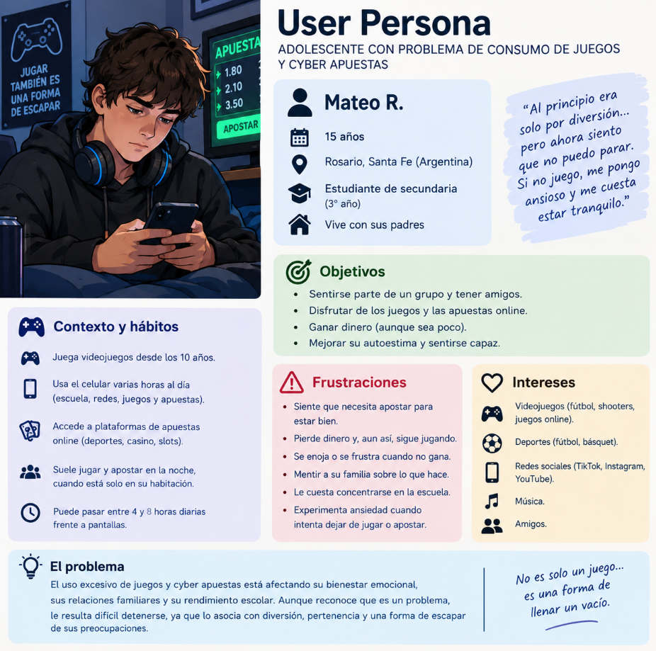
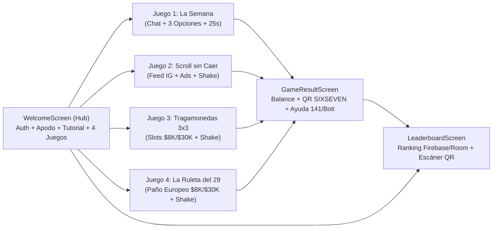

# Juego Limpio 2.0 (Concientización sobre Ciberapuestas en Adolescentes)

**Instituto de Formación Técnica Superior N.º 18 (IFTS 18)**  
**Tecnicatura Superior en Desarrollo de Software**  
**Materia:** Desarrollo de Aplicaciones para Dispositivos Móviles (DAM)  
**Trabajo Grupal:** Grupo 1 (Segunda Entrega, Evolución de la App-Juego)  
**Presentación Final:** 18/11 (Presencial)

## A. Descripción de los juegos y experiencia del jugador

Para esta segunda entrega ampliamos *Juego Limpio* con cuatro juegos distintos dentro de la misma app Android (Jetpack Compose y Material 3). Sumamos persistencia local con Room/SQLite, login y ranking en vivo con Firebase, interacciones con el acelerómetro, un tutorial guiado, la pantalla de castigo *"Sin celu hasta el lunes"* y 7 medallas, incluyendo un Easter Egg por código QR (`SIXSEVEN`).

### 1. La Semana: Una Decisión Más (evolución del juego anterior)

El objetivo es atravesar los 7 días de la semana escolar cuidando los `$15.000` iniciales, sumando Puntos de Bienestar y llegando al domingo con `$0` de deuda.

Respecto a la primera entrega, ahora cada día tiene 3 opciones y un reloj de 25 segundos (con la música acelerando a `1.35x` y sonido de latido cuando queda poco tiempo). Se registra cuánto tardás en elegir cada respuesta en milisegundos para desempatar en el ranking.

Agregamos situaciones nuevas como el fulbito con amigos frente a la apuesta fija, un error de transferencia de `$80.000` de tu mamá (que da el trofeo *100% Honrado*), el saldo de la SUBE, anuncios de influencers y préstamos de `$20.000` que te frenan la pantalla hasta que agitás el celular, el premio por aprobar exámenes y el Superclásico del finde. Si cerrás la app a mitad de la semana podés seguir después desde el último día guardado. Si terminás endeudado o apostás plata que no es tuya, salta la pantalla de castigo *"Sin celu hasta el lunes"* con los contactos de ayuda (Línea 141 y Boti).

### 2. Scroll sin Caer

Acá tenés que recorrer un feed estilo Instagram en modo oscuro de punta a punta esquivando publicidades de casinos y préstamos rápidos sin tocar los botones trampa.

Mientras scrolleás el teléfono vibra y aparecen pop-ups que tapan la pantalla con el botón `[X]` trabado. Para sacarlos de encima hay que agitar físicamente el celular hasta llenar la barra de resistencia (en emulador también tenés un botón para simular la sacudida y otro para volver al Hub). Al superarlo desbloqueás la medalla *Ad evadido*.

### 3. Tragamonedas Jackpot 777

Es un simulador 3x3 pensado para mostrar en la práctica por qué la banca siempre termina arriba. Arrancás con un bono de `$8.000` y podés girar agitando el celular o tocando **Girar**, con modos Turbo e Intriga.

El algoritmo replica los trucos reales de las plataformas: al principio te da premios chicos y medianos hasta un techo de `$24.500` para engancharte, mete jugadas *Near-Miss* con el `777` pasando cerca, festeja pérdidas como si hubieras ganado y esconde un mínimo de retiro imposible de alcanzar (`$30.000`). Cuando te quedás sin saldo aparece un cajero simulado que carga `$5.000` pero te descuenta un 20% de comisiones (15% más 5% operativo, te acreditan `$4.000`) antes de dejarte en cero. Si te plantás a tiempo ganás la medalla *Ojo abierto*, y el avance queda guardado por si salís al menú.

### 4. La Ruleta del 29

Muestra la ventaja matemática de la ruleta europea (el `0` verde y los pagos desparejos) sobre un paño del `0` al `36` donde podés elegir fichas y apostar a Pleno o Color.

Igual que en las tragamonedas, empezás con `$8.000` de bono y un límite de retiro bloqueado en `$30.000`. Podés tirar agitando el celular o con el botón de giro. Mantiene las rachas iniciales por debajo de `$24.500`, aplica el cajero simulado con 20% de descuento al quedarte sin fichas, guarda el progreso y premia con puntaje si sabés frenar a tiempo.

### Onboarding, tutorial y privacidad

Después del splash inicial podés entrar rápido solo con un apodo (sesión anónima), con Email y contraseña o con Google. Incluso si entrás con Google o Email, la app nunca toma ni muestra tu nombre real ni tu correo en el ranking. Siempre te pide elegir un apodo y un avatar propios antes de dejarte jugar.

La primera vez corre un tutorial de 5 pasos que señala el apodo, el avatar, el botón de silencio, los juegos y el ranking con medallas. Si querés verlo de nuevo está en el botón `?` del Hub.

## B. Navegación y arquitectura MVVM

La app separa responsabilidades bajo MVVM:

En **Model** (`data/`) viven los estados inmutables en `GameModels.kt` (`GameState`, `SlotsGameState`, `RouletteGameState`, `AuthUiState`, `RankingEntry`), los guiones en `GameScenariosRepository.kt`, la base local en `GameDatabase.kt` y la capa remota en `AuthRepository.kt` y `FirebaseRankingRepository.kt`.

En **ViewModel** (`ui/viewmodel/GameViewModel.kt`) se centraliza la lógica de puntaje, la lectura y escritura en Room/Firebase y el disparo de audios, exponiendo todo mediante `StateFlow` (`gameState`, `slotsState`, `rouletteState`, `authState`, `rankingList`, `isFirebaseOnline`, `firebaseStatusText`).

En **View** (`ui/screens/` y `ui/components/`) están las pantallas en Jetpack Compose (`WelcomeScreen`, `GameDecisionScreen`, `ScrollAdsGameScreen`, `SlotsTrapGameScreen`, `RouletteTrapGameScreen`, `GameResultScreen`, `LeaderboardScreen`) y los modales (`AuthOnboardingModal`, `TutorialCoachmarkOverlay`, `WithdrawBonusModal`, `CashierDepositModal`).

## C. Almacenamiento local (Room/SQLite) y nube (Firebase)

### 1. Base de datos local con Room (`com.ifts18.unadecisionmas.data.local`)

En `GameDatabase.kt` implementamos `AppDatabase` (versión 4) junto a `GameDao`. Todos los registros quedan separados por `uid` para que dos cuentas distintas no se pisen en el mismo teléfono.

Usamos cuatro entidades: `SavedGameEntity` (`saved_game`) guarda el checkpoint completo de *La Semana* con día, deuda, ahorros, bienestar, tiempo acumulado e historial serializado. `AchievementEntity` (`achievements`) lleva las 7 medallas desbloqueadas (`INTOCABLE`, `HONRADO_100`, `EVITANDO_TENTACION`, `OJO_ABIERTO`, `VIDA_REAL`, `TODO_AL_ROJO` y `SIXSEVEN`), que también se replican en `/users/{uid}/achievements`. `LocalScoreEntity` (`local_scores`) guarda el historial de puntajes locales y funciona como cola offline (`isSynced = false`) cuando no hay conexión. Por último, `MinigameProgressEntity` (`minigame_progress`) persiste el estado en curso de *Tragamonedas* (`SLOTS`) y *Ruleta* (`ROULETTE`).

### 2. Autenticación y ranking en Firebase (`com.ifts18.unadecisionmas.data.remote`)

`AuthRepository` maneja login anónimo con apodo, Email/contraseña y Google Sign-In mediante `GoogleSignInClient` (`play-services-auth:21.2.0`, compatible con Android 7 a 16). El apodo, el avatar y las medallas se guardan en `/users/{uid}` sin publicar correos ni nombres reales.

`FirebaseRankingRepository` sincroniza en tiempo real el nodo `ranking_juego_limpio` en Firebase Realtime Database con respaldo REST firmado por ID Token. Cuando vuelve internet o el usuario inicia sesión, `refreshRanking()` sube automáticamente los puntajes que habían quedado pendientes en Room.

El ranking ordena las partidas con tres criterios:

1. Mayor `score` competitivo.
2. Menor `totalTimeMillis` para desempatar por rapidez.
3. Mayor `achievementsCount` en la sesión.

En `database.rules.json` exigimos `auth != null` para leer y escribir. En `ranking_juego_limpio/$entryId` validamos que `uid` coincida con `auth.uid` para que nadie pueda modificar puntajes de otro usuario, además de chequear tipos y rangos (`score >= 0`, `debt >= 0`, `playerName` de 1 a 30 caracteres). La rama `/users/$uid` queda restringida exclusivamente a su dueño (`auth.uid === $uid`).

No hay credenciales ni claves privadas subidas al repo: `local.properties` y `google-services.json` están ignorados en `.gitignore`, y los valores de Firebase se inyectan en `BuildConfig` desde `local.properties` (dejamos `local.properties.example` como plantilla).

## D. Sensores, multimedia, ciclo de vida y Easter Egg QR

### 1. Acelerómetro (`DeviceSensorManager.kt`)

`rememberAccelerometerMonitor` usa `Sensor.TYPE_ACCELEROMETER` para medir el movimiento del teléfono. En cada lectura divide los valores de los tres ejes por la gravedad (`SensorManager.GRAVITY_EARTH`) y calcula la fuerza resultante en `g`.

Cuando esa fuerza supera el umbral configurado (`1.38f` en *La Semana* y *Scroll sin Caer*, `1.42f` en *Tragamonedas* y *La Ruleta del 29*, con `1.45f` por defecto en el monitor), dispara vibración háptica (`HapticFeedbackHelper`) y actualiza el estado del juego: destruye los anuncios invasivos en los dos primeros o acciona los giros en los simuladores de casino.

El listener del sensor se engancha con `LifecycleEventObserver` y `DisposableEffect`: se registra en `ON_RESUME` y se libera en `ON_PAUSE`, `ON_STOP` y `onDispose` para no gastar batería en segundo plano.

### 2. Multimedia y ciclo de vida (`SoundManager.kt` y `MainActivity.kt`)

La app combina música de fondo (`MediaPlayer`, que acelera a `1.35x` en los últimos segundos de decisión), efectos cortos (`SoundPool`), animaciones Lottie y vibración háptica. `MainActivity` conecta `onStart`/`onResume` con `onAppForeground` y `onPause`/`onStop`/`onDestroy` con `onAppBackground` y `release()`, pausando o liberando el audio apenas el usuario sale de la aplicación.

### 3. Easter Egg `"SIXSEVEN"` por código QR

En `GameResultScreen` y `LeaderboardScreen` podés mostrar tu QR generado con `ZXing Core` desde `QrCodeHelper.kt` (payload `JUEGOLIMPIO://ACHIEVEMENT/SIXSEVEN_67`) o escanear el de un compañero usando el permiso de `CAMERA`. Al leerlo desbloquea en Room la medalla `#67 SixSeven` y suma `+2.500 pts`.

## E. Prototipo y Design System

Podés ver los recursos de diseño y documentación complementaria en estos enlaces:

* Tablero de Figma: [Neon App UI (Community) en Figma](https://www.figma.com/design/bzjU3l80OI4mZELeOXOe39/Neon-App-UI--Community-?node-id=0-1&p=f&t=gZUvsA5NlCMdfpsa-0)
* Planificación del equipo: [Ideas TP Final DAM en Google Sheets](https://docs.google.com/spreadsheets/d/1mHGR6sgE00ajy3xh7x63RE8tmT0FaXarh0_mcfX1OTg/edit?gid=1046150818#gid=1046150818)
* Relato pedagógico detallado: [relato.md](relato.md)

## F. Participación de los integrantes (Segunda Entrega)

| Integrante | Rol en el Equipo | Tareas Realizadas |
| :--- | :--- | :--- |
| **Martín Jonas Avilas** | Líder IT & Arquitectura Android | Arquitectura MVVM (`GameViewModel`, `StateFlow`), persistencia Room/SQLite (4 entidades aisladas por `uid` en `AppDatabase` v4), integración de Firebase Auth (Anónimo, Email, Google Play Services Auth), RTDB, `database.rules.json`, generador/escáner QR `SIXSEVEN` y build sin credenciales expuestas. |
| **Evelyn Gaitán** | Narrative Designer & Mecánicas de Sensor | Diseño de la mecánica de sacudida con Acelerómetro (*"Evitando tentación"*), guiones de *El Error de Transferencia ($80.000)* y *La plata de la SUBE*, co-diseño de *Tragamonedas* y *La Ruleta del 29*, y recursos Lottie/Multimedia. |
| **Roberto Araujo** | Diseñador UX / Sistemas de Puntaje | Sistema de Puntos de Bienestar y Ahorro, escenarios saludables (*Fulbito y Cine con amigos*), pantalla de castigo *"Sin celu hasta el lunes"*, diseño del tutorial guiado y tokens visuales del Design System. |
| **Juan Chaile** | Game Designer & Firebase Ranking | Ranking compartido en Firebase (`ranking_juego_limpio`), fórmula de puntaje competitivo con desempate por milisegundos, escenario del *Superclásico*, flujo de onboarding con apodo obligatorio y prototipado de pantallas. |
| **Lucía Marisol Pobeda** | Investigadora UX & Simulador de Casino | Diseño de anuncios invasivos de *Influencers* y *Préstamos de $20.000* con vibración para *Scroll sin Caer*, co-diseño pedagógico de *Tragamonedas 3x3* y *La Ruleta del 29*, y validación de canales de ayuda (Línea 141 y Boti). |

## G. Instrucciones para ejecutar la aplicación

1. Clonar el repositorio y abrir la carpeta raíz en Android Studio (Iguana, Jellyfish, Ladybug o superior).
2. Configurar Gradle con **JDK 17** (*Settings -> Build, Execution, Deployment -> Build Tools -> Gradle -> Gradle JDK = 17*).
3. Copiar `local.properties.example` como `local.properties` y completar `sdk.dir` junto con las claves de Firebase (`FIREBASE_DB_URL`, `FIREBASE_PROJECT_ID`, `FIREBASE_API_KEY`, `FIREBASE_APP_ID`, `GOOGLE_WEB_CLIENT_ID`).
4. Compilar con `./gradlew assembleDebug` o correr directo desde Android Studio en un teléfono Android físico (recomendado para probar el acelerómetro y la cámara QR) o en un emulador con Google Play Services.
