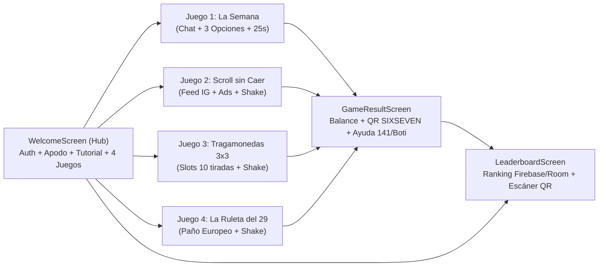
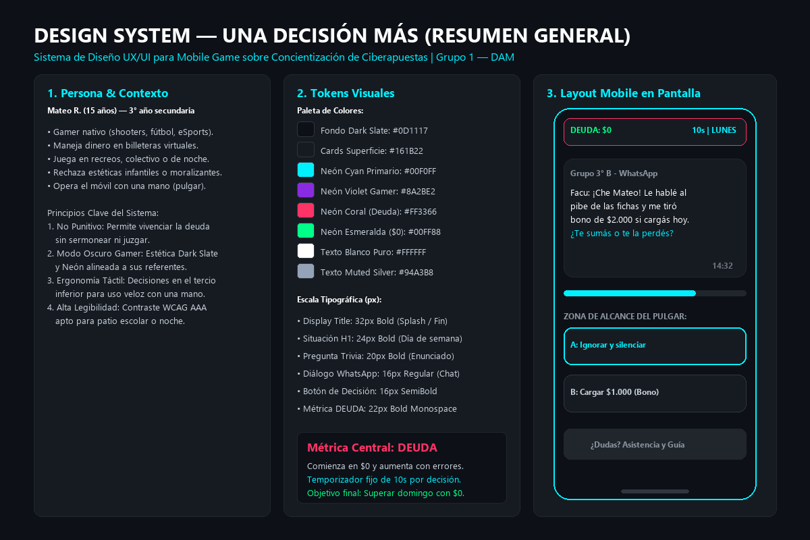

# Juego Limpio 2.0 — Concientización sobre Ciberapuestas en Adolescentes

**Instituto de Formación Técnica Superior N.º 18 (IFTS 18)**  
**Tecnicatura Superior en Desarrollo de Software**  
**Materia:** Desarrollo de Aplicaciones para Dispositivos Móviles (DAM)  
**Trabajo Grupal:** Grupo 1 — Segunda Entrega (Evolución de la App-Juego)  
**Presentación Final:** 18/11 — Presencial  

---

## A. Descripción de los Juegos y Experiencia del Jugador

En esta segunda etapa evolucionamos *Juego Limpio* integrando **cuatro experiencias de juego completas y diferenciadas** dentro de una misma aplicación Android (Jetpack Compose + Material 3), conectadas a **Room/SQLite**, **Firebase Authentication + Realtime Database**, **sensores de movimiento (Acelerómetro)**, un **tutorial interactivo guiado**, un **emulador de castigo ("Sin celu hasta el lunes")** y un sistema de **7 medallas con Easter Egg por Código QR (`SIXSEVEN`)**.

### 1. Juego 1 (Evolución): *"La Semana: Una Decisión Más"* (Modo Historia Contrarreloj)
* **Objetivo:** Superar los 7 días de la semana escolar (Lunes a Domingo) protegiendo tus ahorros iniciales (`$15.000`), sumando **Puntos de Bienestar** y terminando con **`$0` de deuda**.
* **Mejoras incorporadas en la 2.ª entrega:**
  * Se pasó de 2 a **3 alternativas de decisión por día** con temporizador de **25 segundos** (aceleración musical a `1.35x` y latido cardíaco en el tramo final).
  * Métricas de **Ahorro (`$`)**, **Bienestar (`★`)** y medición en milisegundos del tiempo de respuesta para desempatar en el ranking.
  * Nuevos escenarios cotidianos: *Canchita de fútbol 5 con amigos vs. Apuesta fija*, *El error de transferencia de mamá por `$80.000`* (trofeo **100% Honrado**), *El saldo de la SUBE*, *Influencers fitness y préstamos instantáneos de `$20.000`* (interrupción con Acelerómetro), *Premio por aprobar exámenes* y *El Superclásico del fin de semana*.
  * **Guardado automático (Checkpoint en Room):** permite cerrar la app a mitad de semana y retomar desde el último día guardado.
  * **Emulador de castigo (*"Sin celu hasta el lunes"*):** si cerrás con deuda o apostás la plata ajena, se muestra el teléfono bloqueado como consecuencia narrativa junto a la línea de ayuda (**Línea 141** y **Boti**).

### 2. Juego 2 (Mecánica Diferenciada + Sensor): *"Scroll sin Caer"*
* **Objetivo:** Scrollear un feed estilo **Instagram en modo oscuro** de principio a fin superando anuncios invasivos de casinos y préstamos sin caer en los botones trampa.
* **Mecánica con Acelerómetro:** Durante el scroll el teléfono vibra y saltan pop-ups patrocinados que bloquean la pantalla (con el botón `[X]` trabado). Para destruir cada anuncio y continuar, el jugador debe **agitar físicamente el celular** hasta completar la barra de resistencia medida por el acelerómetro (incluye botón de simulación en emulador y acceso de regreso al Hub). Desbloquea la medalla **Ad evadido**.

### 3. Juego 3 (Simulador Algorítmico + Sensor): *"Tragamonedas Jackpot 777"*
* **Objetivo:** Demostrar experimentalmente por qué *la casa siempre gana* en las máquinas virtuales 3x3.
* **Mecánica con Acelerómetro y Persistencia:** Comienza con **10 fichas de bono** y gira los 3 rodillos vectoriales agitando el teléfono o tocando **Girar**. Expone el algoritmo en 3 etapas: *El Gancho* (premio bloqueado bajo Rollover), *Near-Miss* (`777` pasando rozando) y *Vaciado Estadístico (`RTP < 95%`)*. El jugador puede **"Plantarse a tiempo"** para desbloquear la medalla **Ojo abierto**, o salir y retomar más tarde gracias a `MinigameProgressEntity` en Room.

### 4. Juego 4 (Simulador Algorítmico + Sensor): *"La Ruleta del 29"*
* **Objetivo:** Mostrar la ventaja matemática de la banca europea (el **0 Verde** y los pagos asimétricos) mediante una ruleta interactiva.
* **Mecánica con Acelerómetro y Persistencia:** Permite elegir apuestas de tipo **Pleno** o **Color**, girar el paño agitando el celular (10 fichas de bono) y observar cómo el algoritmo alterna rachas iniciales y vaciado progresivo. Guarda el progreso en curso en Room (`MinigameProgressEntity`) y permite plantarse a tiempo para sumar puntaje competitivo.

### Onboarding, Tutorial Interactivo y Privacidad
* **Acceso con Firebase Auth + Apodo Obligatorio:** Al iniciar (luego del splash Lottie), el jugador puede elegir entre **Entrar rápido con Apodo** (`Anonymous`), **Email y contraseña** o **Continuar con Google** (`Credential Manager`).
* **Protección de identidad:** Incluso ingresando con Google o Email, la app **nunca** usa ni expone el nombre real o correo en el ranking; exige definir un **apodo y avatar** privados antes de habilitar el juego.
* **Tutorial guiado de 5 pasos (`TutorialCoachmarkOverlay`):** Recorre Apodo, Avatar, Silencio, Grilla de Juegos y Ranking/Medallas (repetible desde el botón `?` del Hub).

---

## B. Estructura de Navegación y Arquitectura MVVM

* **Model (`data/`):** `GameModels.kt` (estados inmutables `GameState`, `SlotsGameState`, `RouletteGameState`, `AuthUiState`, `RankingEntry`), `GameScenariosRepository.kt`, `GameDatabase.kt` (Room), `AuthRepository.kt` y `FirebaseRankingRepository.kt`.
* **ViewModel (`ui/viewmodel/GameViewModel.kt`):** Expone `StateFlow` reactivos (`gameState`, `slotsState`, `rouletteState`, `authState`, `rankingList`, `isFirebaseOnline`, `firebaseStatusText`), coordina Room, Firebase Auth/RTDB, cálculo de puntaje y eventos multimedia.
* **View (`ui/screens/`, `ui/components/`):** Pantallas 100% declarativas en Jetpack Compose (`WelcomeScreen`, `GameDecisionScreen`, `ScrollAdsGameScreen`, `SlotsTrapGameScreen`, `RouletteTrapGameScreen`, `GameResultScreen`, `LeaderboardScreen`) y modales desacoplados (`AuthOnboardingModal`, `TutorialCoachmarkOverlay`).

---

## C. Almacenamiento Local (Room/SQLite) y Nube (Firebase)

### 1. Base de datos local con Room y SQLite (`com.ifts18.unadecisionmas.data.local`)
Se implementó `AppDatabase` (versión 3) con `GameDao` y **cuatro entidades**:
* **`SavedGameEntity` (`saved_game`):** Checkpoint completo de *La Semana* (`playerName`, `avatarResId`, `currentDayIndex`, `currentDebt`, `currentSavings`, `wellbeingPoints`, `totalDecisionTimeMillis` e historial serializado) para retomar la partida tras cerrar la app.
* **`AchievementEntity` (`achievements`):** Registra las 7 medallas desbloqueadas localmente (`INTOCABLE`, `HONRADO_100`, `EVITANDO_TENTACION`, `OJO_ABIERTO`, `VIDA_REAL`, `TODO_AL_ROJO` y el Easter Egg `SIXSEVEN`).
* **`LocalScoreEntity` (`local_scores`):** Guarda el historial local de puntajes de cada partida y funciona como **caché y cola de sincronización offline** (`isSynced = false`) cuando no hay red o sesión.
* **`MinigameProgressEntity` (`minigame_progress`):** Persiste el avance en curso de *Tragamonedas Jackpot 777* (`SLOTS`) y *La Ruleta del 29* (`ROULETTE`) al salir al Hub o pasar a segundo plano.

### 2. Autenticación y Ranking Compartido con Firebase (`com.ifts18.unadecisionmas.data.remote`)
* **`AuthRepository` (Firebase Authentication):** Soporta inicio anónimo rápido con apodo, Email/Contraseña y Google Sign-In mediante `Credential Manager` (`androidx.credentials` + `googleid`). El apodo y avatar elegidos se resguardan en `/users/{uid}` sin almacenar ni publicar emails o nombres reales en el ranking.
* **`FirebaseRankingRepository` (Firebase Realtime Database):** Sincroniza en tiempo real el nodo `ranking_juego_limpio` usando el SDK autenticado (con respaldo REST firmado con ID Token). Al volver la conectividad o iniciar sesión, sube automáticamente los puntajes pendientes de Room (`refreshRanking()`).
* **Criterio de ordenamiento y desempate:**
  1. Mayor `score` competitivo.
  2. Menor `totalTimeMillis` (desempate por rapidez).
  3. Mayor `achievementsCount` (cantidad de medallas en la sesión).
* **Reglas de seguridad (`database.rules.json`):**
  * Exigen `auth != null` para lectura y escritura.
  * Validan en `ranking_juego_limpio/$entryId` que `newData.child('uid').val() === auth.uid`, tipos/rangos válidos (`score >= 0`, `debt >= 0`, `playerName` no vacío) e impiden modificar registros ajenos.
  * Restringen `/users/$uid` exclusivamente al propio usuario (`auth != null && auth.uid === $uid`).
* **Cero credenciales en el repositorio:** `local.properties` y `google-services.json` están excluidos en `.gitignore`. Las propiedades de conexión se inyectan a `BuildConfig` desde `local.properties` (plantilla de ejemplo en `local.properties.example`).

---

## D. Uso de Sensores, Multimedia, Ciclo de Vida y Easter Egg QR (`SIXSEVEN`)

### 1. Sensor Acelerómetro (`Sensor.TYPE_ACCELEROMETER`)
Implementado en `DeviceSensorManager.kt` (`rememberAccelerometerMonitor`):
* Calcula la aceleración resultante en tiempo real:
  $$G = \sqrt{\left(\frac{a_x}{g}\right)^2 + \left(\frac{a_y}{g}\right)^2 + \left(\frac{a_z}{g}\right)^2}$$
* Cuando $G \ge 1.38\,g$, activa vibración háptica (`HapticFeedbackHelper`) y modifica el estado del juego:
  * Destruye anuncios invasivos en *La Semana* (Jueves) y *Scroll sin Caer*.
  * Acciona los giros de *Tragamonedas Jackpot 777* y *La Ruleta del 29*.
* **Ciclo de vida:** Registra el `SensorEventListener` en `ON_RESUME` y lo libera en `ON_PAUSE`, `ON_STOP` y `onDispose` mediante `LifecycleEventObserver` + `DisposableEffect`.

### 2. Multimedia y Ciclo de Vida (`SoundManager.kt` y `MainActivity.kt`)
* Música de fondo adaptativa (`MediaPlayer`, velocidad `1.35x` en cuenta regresiva), efectos SFX (`SoundPool`), animaciones vectoriales **Lottie** y vibración háptica.
* `MainActivity` gestiona `onStart`/`onResume` (`onAppForeground`) y `onPause`/`onStop`/`onDestroy` (`onAppBackground` y `release()`), evitando consumo de audio o batería en segundo plano.

### 3. Easter Egg `"SIXSEVEN"` (#67) mediante Código QR
* En `GameResultScreen` y `LeaderboardScreen`, el jugador puede mostrar su QR generado con `ZXing Core` (`QrCodeHelper.kt`, payload `JUEGOLIMPIO://ACHIEVEMENT/SIXSEVEN_67`) o escanear el de un compañero con cámara (`CAMERA`), desbloqueando en Room la medalla `#67 SixSeven` (`+2.500 pts`).

---

## E. Prototipo y Design System

* **Tablero de Figma:** [Neon App UI (Community) en Figma](https://www.figma.com/design/bzjU3l80OI4mZELeOXOe39/Neon-App-UI--Community-?node-id=0-1&p=f&t=gZUvsA5NlCMdfpsa-0)
* **Planificación e Ideas del Equipo:** [Ideas TP Final DAM en Google Sheets](https://docs.google.com/spreadsheets/d/1mHGR6sgE00ajy3xh7x63RE8tmT0FaXarh0_mcfX1OTg/edit?gid=1046150818#gid=1046150818)
* **Relato pedagógico detallado:** [relato.md](relato.md)

---

## F. Participación de los Integrantes (Segunda Entrega)

| Integrante | Rol en el Equipo | Tareas Realizadas |
| :--- | :--- | :--- |
| **Martín Jonas Avilas** | Líder IT & Arquitectura Android | Arquitectura MVVM (`GameViewModel`, `StateFlow`), persistencia Room/SQLite (4 entidades en `AppDatabase` v3), integración completa de Firebase Auth (Anónimo, Email, Google Credential Manager) + RTDB + `database.rules.json`, generador/escáner QR `SIXSEVEN` y build sin credenciales expuestas. |
| **Evelyn Gaitán** | Narrative Designer & Mecánicas de Sensor | Diseño de la mecánica de sacudida con Acelerómetro (*"Evitando tentación"*), guiones de *El Error de Transferencia ($80.000)* y *La plata de la SUBE*, co-diseño de *Tragamonedas* / *La Ruleta del 29* y recursos Lottie/Multimedia. |
| **Roberto Araujo** | Diseñador UX / Sistemas de Puntaje | Sistema de Puntos de Bienestar y Ahorro, escenarios saludables (*Fulbito y Cine con amigos*), emulador de castigo *"Sin celu hasta el lunes"*, diseño del tutorial guiado y tokens visuales del Design System. |
| **Juan Chaile** | Game Designer & Firebase Ranking | Ranking compartido en Firebase (`ranking_juego_limpio`), fórmula de puntaje competitivo con desempate por milisegundos, escenario del *Superclásico*, flujo de onboarding con apodo obligatorio y prototipado de pantallas. |
| **Lucía Marisol Pobeda** | Investigadora UX & Simulador de Casino | Diseño de anuncios invasivos de *Influencers* y *Préstamos de $20.000* con vibración para *Scroll sin Caer*, co-diseño pedagógico de *Tragamonedas 3x3* y *La Ruleta del 29*, y validación de canales de ayuda (Línea 141 y Boti). |

---

## G. Instrucciones para Ejecutar la Aplicación

1. Clonar el repositorio y abrir la carpeta raíz en **Android Studio (Iguana / Jellyfish / Ladybug o superior)**.
2. Verificar que Gradle utilice **JDK 17** (*Settings -> Build, Execution, Deployment -> Build Tools -> Gradle -> Gradle JDK = 17*).
3. Copiar `local.properties.example` como `local.properties` (archivo ignorado por Git) y completar `sdk.dir` junto con las propiedades de Firebase (`FIREBASE_DB_URL`, `FIREBASE_PROJECT_ID`, `FIREBASE_API_KEY`, `FIREBASE_APP_ID`, `GOOGLE_WEB_CLIENT_ID`).
4. Ejecutar `./gradlew assembleDebug` o correr directamente desde Android Studio en un dispositivo físico Android (recomendado para probar el **Acelerómetro** y la **Cámara QR**) o emulador con Google Play Services.
