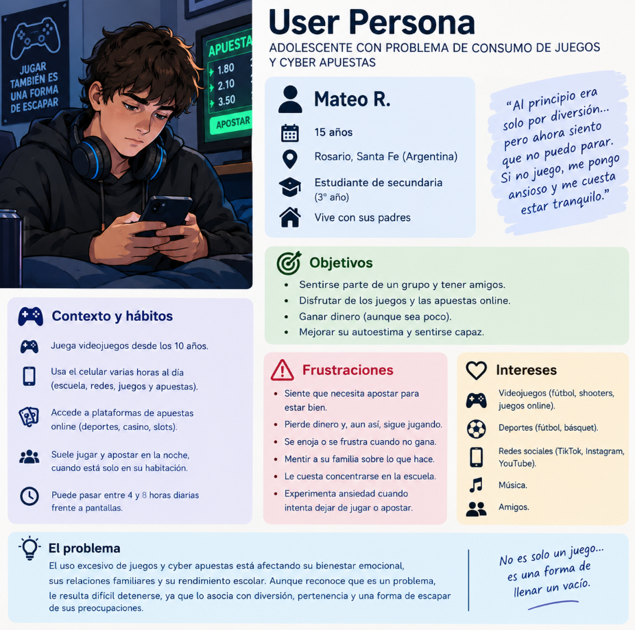
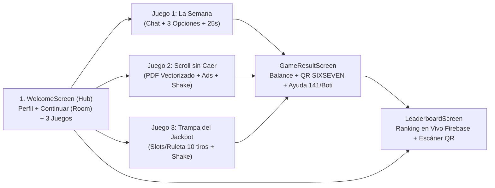
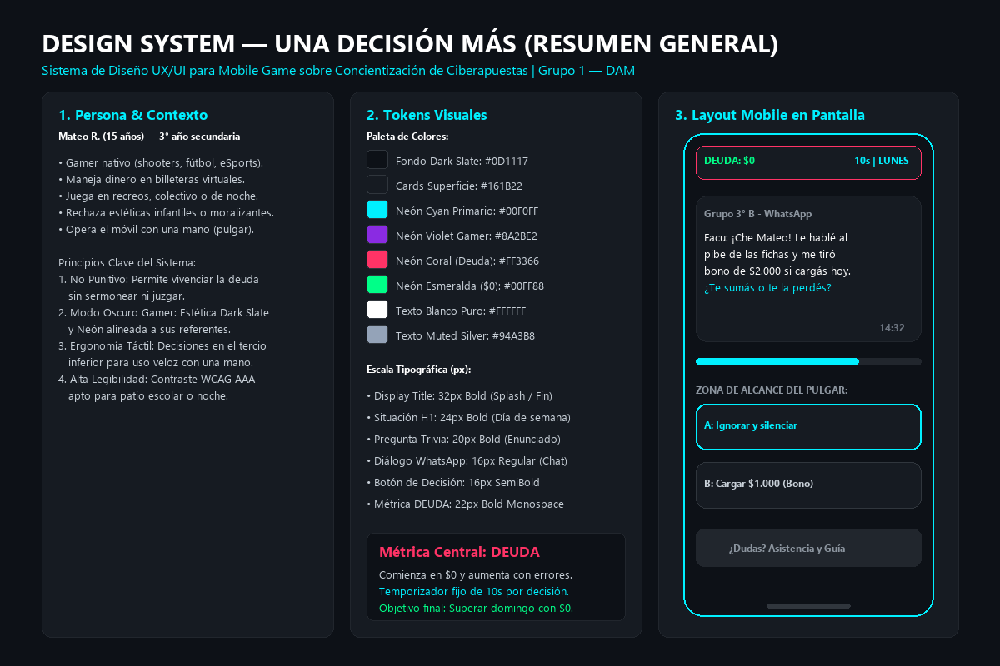

# Juego Limpio 2.0 - Concientización sobre Ciberapuestas en Adolescentes

**Instituto de Formación Técnica Superior N.° 18 (IFTS 18)**  
**Tecnicatura Superior en Desarrollo de Software**  
**Materia:** Desarrollo de Aplicaciones para Dispositivos Móviles (DAM)  
**Trabajo Grupal:** Grupo 1 — Segunda Entrega (Evolución de la App-Juego)  
**Presentación Final:** 18/11 — Presencial  

---

## A. Descripción de los Juegos y Experiencia del Jugador

En esta segunda etapa evolucionamos *Juego Limpio* integrando **tres experiencias de juego completas y diferenciadas** dentro de una misma aplicación, conectadas a una base de datos local con **Room/SQLite**, un **Ranking en tiempo real con Firebase**, **sensores de movimiento (Acelerómetro)** y un sistema de **logros y Easter Egg por Código QR (`SIXSEVEN`)**.

### 1. Juego 1 (Evolución): *"La Semana: Una Decisión Más"* (Modo Historia Contrarreloj)
* **Objetivo:** Superar los 7 días de la semana escolar (Lunes a Domingo) protegiendo tus ahorros iniciales (`$15.000`), sumando **Puntos de Bienestar** y terminando con **`$0` de deuda**.
* **Mejoras incorporadas en la 2.ª entrega:**
  * Se pasó de 2 a **3 alternativas de decisión por día** con un temporizador ampliado a **25 segundos** (con aceleración musical a 1.35x y latido cardíaco en el tramo final).
  * Incorporación de métricas de **Ahorro (`$`)**, **Bienestar (`★`)** y medición en milisegundos del tiempo de respuesta para desempatar en partidas simultáneas.
  * Nuevos escenarios cotidianos diseñados por el equipo: *Canchita de fútbol 5 con amigos vs. Apuesta fija*, *El error de transferencia de mamá por `$80.000`* (que otorga el trofeo **100% Honrado**), *El saldo de la SUBE*, *Influencers fitness y préstamos instantáneos de `$20.000`* (con interrupción de sensor Acelerómetro), *Premio por aprobar exámenes* y *El Superclásico del fin de semana*.
  * **Guardado automático de partida (Checkpoint en Room):** Si el jugador cierra la app a mitad de la semana, al volver a abrirla puede tocar **"Continuar Partida Guardada"** en el día exacto donde quedó.

### 2. Juego 2 (Mecánica Diferenciada + Sensor): *"Scroll sin Caer: Spam Attack"*
* **Objetivo:** Leer y scrollear de principio a fin un **apunte escolar vectorizado de 6 páginas** (con gráficos en Canvas sobre ventaja matemática de la casa, cuentas demo de influencers y sesgo de confirmación) antes de que se agote el reloj de 60 segundos.
* **Mecánica con Acelerómetro:** A medida que el usuario avanza en el scroll del PDF, el teléfono vibra y saltan **publicidades invasivas de casinos ilegales, préstamos de `$20.000` e influencers** que bloquean el scroll y cuyo botón `[X]` está trabado. Para destruir cada anuncio sin caer en el botón trampa, el jugador debe **agitar físicamente el celular** hasta completar la barra de resistencia medida por el acelerómetro. Otorga la medalla **Evitando Tentación**.

### 3. Juego 3 (Simulador Algorítmico + Sensor): *"La Trampa del Jackpot 🎰"*
* **Objetivo:** Demostrar de forma experimental por qué *la casa siempre gana* en las ruletas y tragamonedas virtuales.
* **Mecánica con Acelerómetro:** El jugador ingresa con un **"Bono de Bienvenida de 10 fichas"** (eligiendo su apuesta de ruleta como *29 Negro*, *Rojo x2* o *0 Verde*) y **agita o inclina el teléfono** para hacer girar los 3 rodillos de emojis (`💎`, `7️⃣`, `🍒`, `🔔`, `🍋`).
* **Radiografía del Algoritmo en 3 Etapas:**
  1. *Tiros 1 y 2 (El Gancho):* El algoritmo regala un acierto inicial pero bloquea el dinero bajo un *Rollover x40*.
  2. *Tiros 3 a 6 (Efecto Near-Miss / Casi Ganás):* Salen dos símbolos iguales y el tercero pasa rozando (`7️⃣ 7️⃣ 🍋`) mientras en la ruleta sale el número contiguo, disparando la ilusión de control.
  3. *Tiros 7 a 10 (Vaciado Estadístico):* El Retorno al Jugador (`RTP < 95%`) vacía las fichas e intenta tentar al usuario a cargar `$5.000` de sus ahorros. Si el jugador decide **"Plantarse a tiempo"**, suma un bonus de puntaje y desbloquea la medalla **Ojo Abierto**.

---

## B. Estructura de Navegación

---

## C. Almacenamiento Local (Room/SQLite) vs. Nube (Firebase)

Para organizar los datos con criterio técnico y de privacidad, dividimos la persistencia en dos capas complementarias:

### 1. ¿Qué guardamos localmente en el celular con Room y SQLite? (`com.ifts18.unadecisionmas.data.local`)
Se implementó `AppDatabase` sobre Room con `GameDao` y tres entidades:
* **`SavedGameEntity` (`saved_game`):** Almacena el estado completo de la partida en curso del Modo Historia (`playerName`, `avatarResId`, `currentDayIndex`, `currentDebt`, `currentSavings`, `wellbeingPoints`, `totalDecisionTimeMillis` e historial serializado). Permite cerrar la aplicación en cualquier día de la semana y retomar luego sin perder progreso.
* **`AchievementEntity` (`achievements`):** Registra las 7 medallas desbloqueadas en el dispositivo (`INTOCABLE`, `HONRADO_100`, `EVITANDO_TENTACION`, `OJO_ABIERTO`, `VIDA_REAL`, `TODO_AL_ROJO` y el Easter Egg `SIXSEVEN`).
* **`LocalScoreEntity` (`local_scores`):** Guarda el historial local de partidas y actúa como cola de sincronización offline (`isSynced = false`) cuando el dispositivo juega sin conexión a internet.

### 2. ¿Qué guardamos en la nube con Firebase? (`com.ifts18.unadecisionmas.data.remote`)
Se implementó `FirebaseRankingRepository` conectado a **Firebase Realtime Database**:
* Al finalizar cualquiera de los juegos, se publica en el nodo `ranking_juego_limpio` el resumen competitivo: apodo, avatar, modo jugado, puntaje total (`score`), ahorro final, deuda, tiempo empleado en milisegundos (`totalTimeMillis`), cantidad de medallas e indicador del Easter Egg `SIXSEVEN`.
* **Criterio de ordenamiento y desempate para partidas simultáneas:**
  1. Mayor `score` competitivo (calculado según ahorro neto + puntos de bienestar + medallas + velocidad).
  2. Menor `totalTimeMillis` (quien resolvió las decisiones en menos segundos gana el desempate).
  3. Mayor cantidad de medallas desbloqueadas.
* **Seguridad de credenciales:** Las claves de conexión se leen desde `local.properties` a través de `BuildConfig` (y no se suben credenciales privadas al repositorio público).

---

## D. Uso de Sensores, Ciclo de Vida y Easter Egg QR (`SIXSEVEN`)

### 1. Sensor Acelerómetro (`Sensor.TYPE_ACCELEROMETER`)
Implementado en `DeviceSensorManager.kt` mediante el hook reactivo `rememberAccelerometerMonitor`:
* Calcula en tiempo real la fuerza G tridimensional:
  $$G = \sqrt{\left(\frac{a_x}{g}\right)^2 + \left(\frac{a_y}{g}\right)^2 + \left(\frac{a_z}{g}\right)^2}$$
* Cuando $G \ge 1.38\,g$, dispara retroalimentación háptica (`Vibrator` / `VibrationEffect`) y:
  * En **Juego 1 (Jueves)** y **Juego 2 (*Scroll sin Caer*)**: Carga la barra de resistencia que rompe los pop-ups publicitarios de préstamos e influencers.
  * En **Juego 3 (*Trampa del Jackpot*)**: Acciona la tirada de los rodillos del tragamonedas y la ruleta.
* **Gestión del Ciclo de Vida:** Utiliza `LifecycleEventObserver` dentro de un `DisposableEffect` para ejecutar `registerListener` únicamente en `ON_RESUME` y liberar el sensor inmediatamente con `unregisterListener` en `ON_PAUSE`, `ON_STOP` y `onDispose`. Del mismo modo, `MainActivity` pausa y reanuda `SoundManager` en `onPause()` / `onResume()`.

### 2. Easter Egg `"SIXSEVEN"` (#67) mediante Código QR entre Dispositivos
* En `GameResultScreen` y `LeaderboardScreen`, el jugador puede tocar **"Mostrar QR #67"**, generando en el acto un código QR vectorial con `ZXing Core` (`QrCodeHelper.kt`) con el payload `JUEGOLIMPIO://ACHIEVEMENT/SIXSEVEN_67`.
* Cuando un compañero escanea ese código desde su propio teléfono tocando **"Escanear QR"** (usando la cámara con permiso `android.permission.CAMERA`), se desbloquea en su base de datos Room la medalla oculta **`#67 SIXSEVEN`**, otorgando `+2.500 puntos` de bonus y la insignia `👾 67` en el ranking global.

---

## E. Prototipo y Design System

* **Tablero de Figma:** [Neon App UI (Community) en Figma](https://www.figma.com/design/bzjU3l80OI4mZELeOXOe39/Neon-App-UI--Community-?node-id=0-1&p=f&t=gZUvsA5NlCMdfpsa-0)
* **Planificación e Ideas del Equipo:** [Ideas TP Final DAM en Google Sheets](https://docs.google.com/spreadsheets/d/1mHGR6sgE00ajy3xh7x63RE8tmT0FaXarh0_mcfX1OTg/edit?gid=1046150818#gid=1046150818)
* **Relato pedagógico detallado:** [relato.md](relato.md)

---

## F. Participación de los Integrantes (Segunda Entrega)

| Integrante | Rol en el Equipo | Tareas Realizadas |
| :--- | :--- | :--- |
| **Martín Jonas Avilas** | Líder IT & Arquitectura Android | Implementación de persistencia local con Room/SQLite (`AppDatabase`, `GameDao`, checkpoint de partida y medallas), generador/escáner QR del Easter Egg `SIXSEVEN`, ampliación a 3 opciones con timer de 25s y coordinación MVVM. |
| **Evelyn Gaitán** | Narrative Designer & Mecánicas de Sensor | Diseño de la mecánica de sacudida con Acelerómetro (*"Evitando tentación"*), guiones de *El Error de Transferencia ($80.000)* y *La plata de la SUBE*, co-diseño del simulador de Tragamonedas/Ruleta y recursos Lottie/Multimedia. |
| **Roberto Araujo** | Diseñador UX / Sistemas de Puntaje | Diseño del sistema de Puntos de Bienestar y Ahorro, escenarios de planes saludables (*Fulbito y Cine con amigos*), maquetación del apunte vectorizado en Canvas y tokens visuales del Design System. |
| **Juan Chaile** | Game Designer & Firebase Ranking | Integración del Ranking compartido en tiempo real con Firebase, fórmula de puntaje competitivo con desempate por tiempo, diseño del escenario del *Superclásico* y prototipado de pantallas. |
| **Lucía Marisol Pobeda** | Investigadora UX & Simulador de Casino | Diseño de los anuncios invasivos de *Influencers* y *Préstamos instantáneos de $20.000* con vibración para *Scroll sin Caer*, co-diseño pedagógico de *La Trampa del Jackpot (10 tiros)* y validación de canales de ayuda (Línea 141 y Boti). |

---

## G. Instrucciones para Ejecutar la Aplicación

1. Clonar el repositorio y abrir la carpeta en **Android Studio ( Iguana / Jellyfish / Ladybug o superior)**.
2. Asegurar que el JDK de Gradle esté configurado en **JDK 17** (*Settings -> Build, Execution, Deployment -> Build Tools -> Gradle -> Gradle JDK = 17*).
3. *(Opcional para Firebase propio)* En el archivo local `local.properties` (no versionado en Git por seguridad), se pueden definir `FIREBASE_DB_URL`, `FIREBASE_PROJECT_ID`, `FIREBASE_API_KEY` y `FIREBASE_APP_ID`. Sin configuración adicional, la aplicación sincroniza contra el endpoint configurado por defecto y respalda todas las operaciones localmente en **Room/SQLite**.
4. Ejecutar en un dispositivo físico Android (recomendado para experimentar el **Acelerómetro** al agitar el teléfono y la **Cámara** al escanear el código QR `SIXSEVEN` entre dos celulares) o en un emulador (incluye botones de simulación de sacudida para pruebas en PC).
