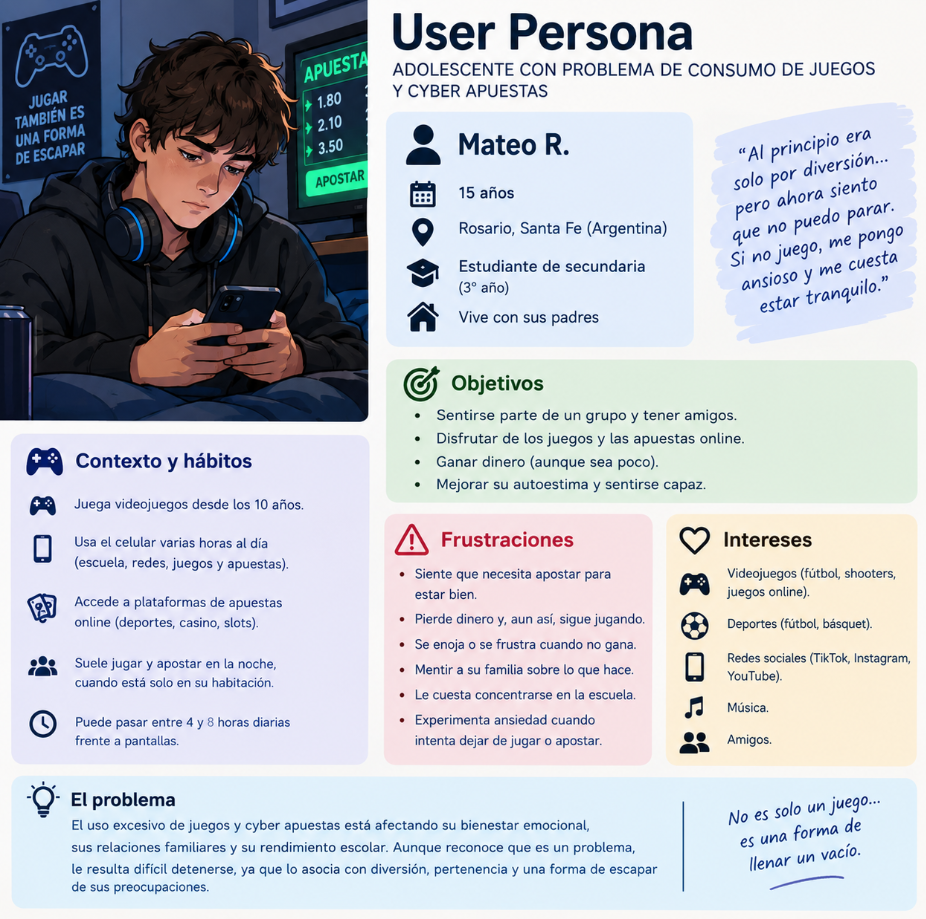
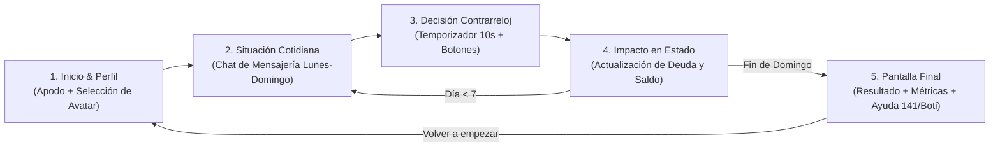
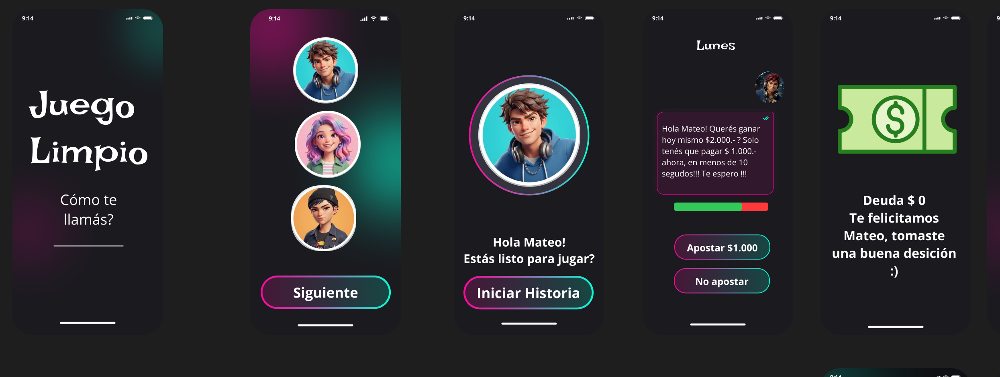
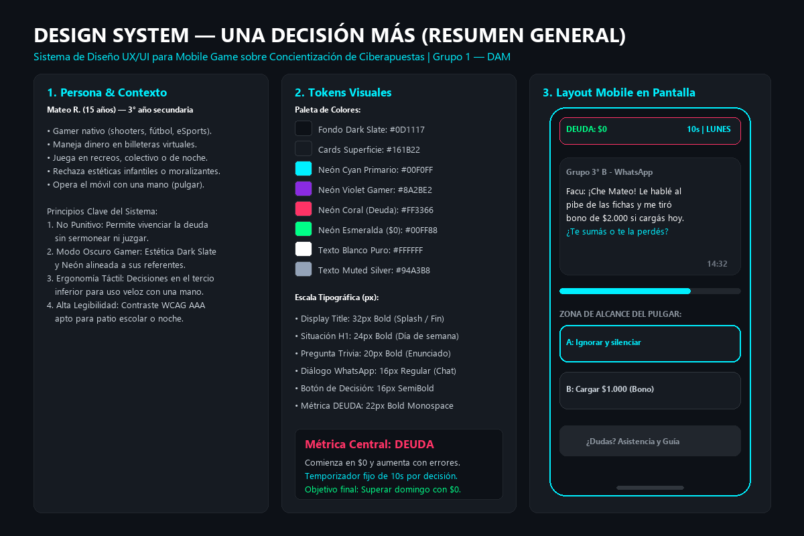
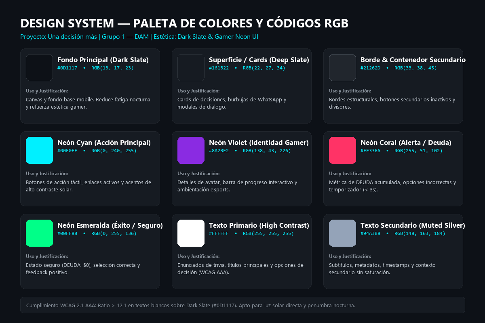
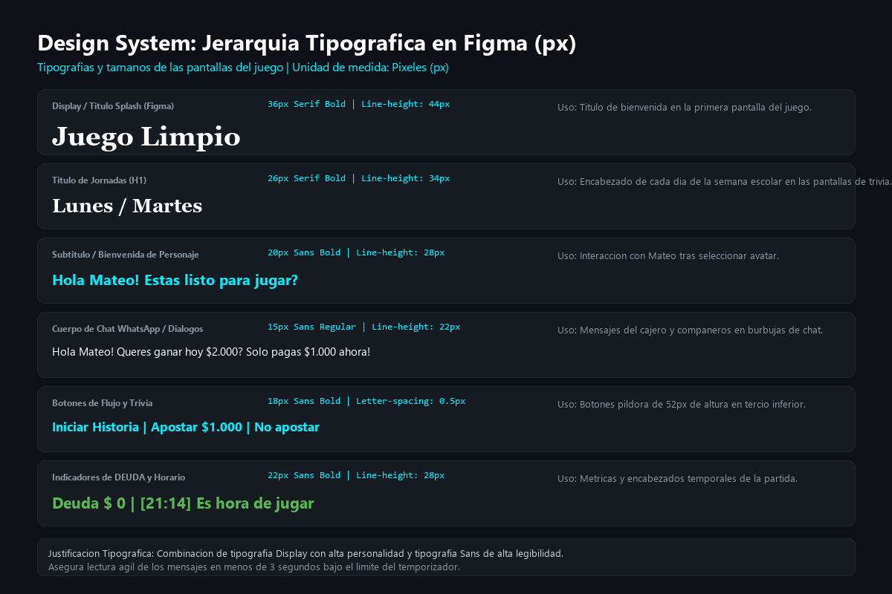
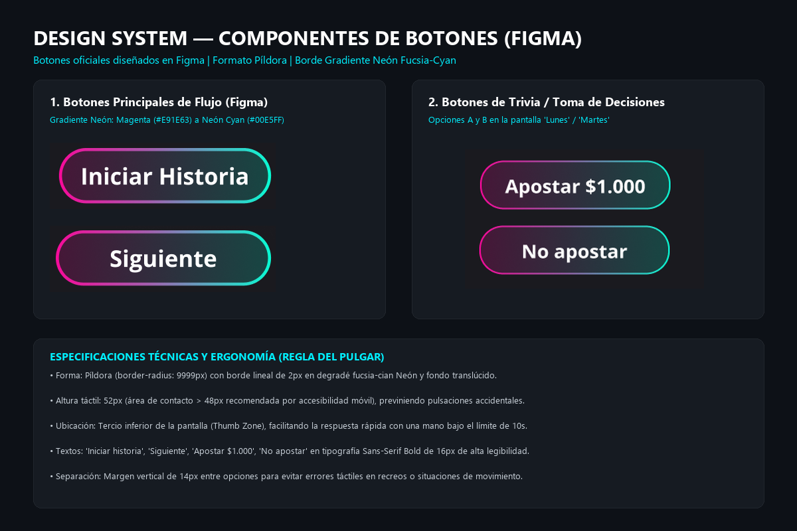

# Juego Limpio - Concientización sobre Ciberapuestas en Adolescentes

**Instituto de Formación Técnica Superior N.° 18 (IFTS 18)**  
**Tecnicatura Superior en Desarrollo de Software**  
**Materia:** Desarrollo para Aplicaciones Móviles (DAM)  
**Trabajo Grupal:** Grupo 1  
**Fecha de Entrega:** 16-10-2026  

---

## A. Descripción del Juego

* **Nombre del Juego:** *Juego Limpio*
* **Objetivo:** Concientizar y prevenir a los adolescentes sobre los riesgos psicosociales y económicos de las apuestas online ilegales, billeteras virtuales y la presión de pares, demostrando mediante la simulación interactiva que las probabilidades matemáticas siempre favorecen a las casas de apuestas (*la casa siempre gana*).
* **Público Destinatario:** Estudiantes de nivel secundario (13 a 18 años), comunidad educativa y familias.
* **Mecánica Principal:** Novela gráfica interactiva en formato de mensajería digital combinada con **trivia contrarreloj de 10 segundos** por decisión. Se inicia con un marcador de **`DEUDA: $0`**. Si el jugador elige la respuesta preventiva adecuada a tiempo, el saldo se conserva intacto. Si elige la opción impulsiva o se agota el tiempo, el sistema suma penalizaciones financieras acumulativas. El objetivo es completar la semana con **$0 de deuda**.
* **Forma de Interacción del Jugador:** Ergonomía adaptada a una sola mano en dispositivos móviles (zona de pulgar). El usuario visualiza mensajes secuenciales, escucha estímulos sonoros de urgencia y selecciona entre dos opciones táctiles ubicadas en el tercio inferior de la pantalla.
* **Recorrido General de la Partida:** La experiencia abarca una semana completa escolar de **Lunes a Domingo** (7 escenarios cotidianos), simulando ofertas de bonos, apuestas deportivas con dinero prestado, falacia de la racha, invisibilización del gasto virtual, persecución de pérdidas (*chasing losses*), FOMO en redes sociales y falsas extorsiones de cajeros virtuales.



---

## B. Estructura de la Aplicación

La navegación sigue una secuencia interactiva y circular con soporte de reinicio:





### Pantallas Principales:
1. **Inicio y Creación de Perfil (`WelcomeScreen`):** Ingreso de apodo del jugador y selección interactiva entre 5 avatares estilizados con anillos de selección neón.
2. **Pantalla de Juego y Decisión (`GameDecisionScreen`):**
   * **TopBar de Estado:** Avatar, apodo, indicador de día (1 a 7), registro visual de decisiones (puntos de acierto/riesgo) y marcador dinámico de **`DEUDA: $XXXX`**.
   * **Área Narrativa:** Flujo conversacional con animaciones de entrada y tipografía uniforme *Space Grotesk*.
   * **Área de Acción:** Temporizador horizontal en Canvas de 10s (con pulso y aceleración en los últimos 4s) y 2 botones píldora de decisión.
3. **Pantalla de Cierre y Resultados (`GameResultScreen`):**
   * **Bloque 1 (Aviso / Resultado):** Título de gran impacto visual (*¡Felicitaciones!* o *¡Atención!*), confeti animado para victoria y reflexión educativa sin juzgar moralmente.
   * **Bloque 2 (Métricas del Jugador):** Cantidad de aciertos vs. desaciertos (sobre 7), saldo final de deuda y desglose paso a paso de cada día en dos columnas.
   * **Bloque 3 (Asistencia y Reinicio):** Botones directos a canales oficiales de orientación (Orientación al Jugador 0800, Chat Boti WhatsApp con animación Lottie, y Línea 141 de consumos problemáticos) y botón principal para volver a empezar.

---

## C. Prototipo y Design System

* **Tablero de Figma:** [Neon App UI (Community) en Figma](https://www.figma.com/design/bzjU3l80OI4mZELeOXOe39/Neon-App-UI--Community-?node-id=0-1&p=f&t=gZUvsA5NlCMdfpsa-0)
* **Planificación grupal:** [Organización TP en Google Sheets](https://docs.google.com/spreadsheets/d/1dQfBnHYNf5ZDdArd4o_fG_jp4r-J3kOh6mL_5OXK1Io/edit?gid=0#gid=0)
* **Relato pedagógico detallado:** [relato.md](relato.md)



### Justificación de las Decisiones Visuales:
Se eligió una estética en **modo oscuro (*Dark Slate*) con acentos neón magenta y cian**, imitando las interfaces de las plataformas gamers y billeteras virtuales que utilizan habitualmente los jóvenes. Esto evita el tono escolarizado tradicional y genera empatía inmediata.

#### 1. Paleta de Colores y Tokens RGB


| Token | Hex | RGB | Propósito en la UI |
| :--- | :--- | :--- | :--- |
| **Fondo General** | `#0D1117` | `RGB(13, 17, 23)` | Fondo principal en modo oscuro para evitar fatiga visual. |
| **Burbuja Chat** | `#24142D` | `RGB(36, 20, 45)` | Fondo de mensajes estilo chat con opacidad y contraste. |
| **Borde Magenta** | `#E91E63` | `RGB(233, 30, 99)` | Gradiente de acento en botones principales y selector de avatar. |
| **Borde Cyan** | `#00E5FF` | `RGB(0, 229, 255)` | Gradiente secundario neón para resaltados y confirmaciones. |
| **Verde Éxito** | `#57B956` | `RGB(87, 185, 86)` | Indicador de deuda $0, aciertos y tramo seguro del tiempo. |
| **Rojo Alerta** | `#FF3B30` | `RGB(255, 59, 48)` | Tramo final de los 10 segundos, botón de riesgo y deuda acumulada. |
| **Texto Principal** | `#FFFFFF` | `RGB(255, 255, 255)` | Texto en blanco puro de alto contraste para máxima legibilidad. |
| **Texto Secundario** | `#A0AEC0` | `RGB(160, 174, 192)` | Metadatos y subtítulos informativos. |

#### 2. Tipografía y Ergonomía


* **Familia:** *Space Grotesk* (Bold, Medium, Regular).
* **Escala:** Display en 64sp, encabezados en 26sp, mensajes de chat en 18.5sp y botones en 15sp.
* **Ergonomía:** Botones de 52dp ubicados en el tercio inferior (*Thumb Zone*) con separación vertical suficiente para prevenir pulsaciones involuntarias en situaciones de cuenta regresiva.



#### 3. Justificación de Modificaciones respecto al Prototipo Original
Durante el paso del prototipo de Figma a la app funcional en Android Studio se hicieron estas adaptaciones técnicas y de UX:
1. **Unificación del Onboarding en una sola pantalla:** En el prototipo original había tres pantallas separadas (Splash, Ingreso de Apodo y Selección de Avatar). Para agilizar la experiencia y evitar pasos vacíos, se integraron en `WelcomeScreen`, donde el usuario elige su avatar, escribe su apodo y arranca directo a jugar.
2. **Entrega secuencial de mensajes:** En Figma la conversación aparecía estática. En la aplicación se programó la llegada progresiva de cada mensaje con delay y tono de notificación, logrando el ritmo de un chat real de WhatsApp.
3. **Aparición condicionada de botones de decisión:** Para que el jugador no toque antes de tiempo por ansiedad, los botones se muestran recién cuando termina de cargarse el último mensaje y se activa el contador de 10 segundos.
4. **Visualizador emergente de capturas:** En el escenario del sábado se incorporó un diálogo a pantalla completa para poder examinar la captura de pantalla ampliada antes de responder.
5. **Estímulos sonoros y aceleración:** Se incorporó música continua que acelera a 1.35x y suma un latido cardíaco en los últimos 4 segundos del temporizador para transmitir la presión real que sufren los adolescentes ante una apuesta contrarreloj.

---

## D. Implementación Técnica

### 1. Aplicación del Patrón MVVM (Model-View-ViewModel)
El proyecto desacopla estrictamente los datos, la lógica de presentación y las vistas:
* **Model (`com.ifts18.unadecisionmas.data.model`):**
  * `PlayerProfile`: Nombre y recurso del avatar seleccionado.
  * `GameScenario` y `DecisionOption`: Encapsula los 7 escenarios de la semana (mensajes secuenciales, montos de penalización, enfoques pedagógicos y opciones preventivas/riesgosas).
  * `GameState`: Estado inmutable con deuda, día actual, aciertos/desaciertos e historial.
* **ViewModel (`com.ifts18.unadecisionmas.ui.viewmodel.GameViewModel`):**
  * Expone un flujo reactivo inmutable `StateFlow<GameState>`.
  * Centraliza las operaciones de negocio: `setPlayerProfile()`, `selectOption()`, `onTimeout()`, `restartGame()`.
  * Evita que los Composables gestionen la lógica de puntuación o el avance de días.
* **View (`com.ifts18.unadecisionmas.ui.screens`):**
  * Vistas declarativas en Jetpack Compose observando `gameState` mediante `collectAsStateWithLifecycle()`.

### 2. Administración del Ciclo de Vida (Activity Lifecycle)
En cumplimiento de la consigna 4:
* `MainActivity` implementa los callbacks del ciclo de vida (`onResume`, `onPause`, `onDestroy`).
* **`SoundManager`** pausa automáticamente la música de fondo y los efectos cuando la aplicación pasa a segundo plano (`onPause`), evitando el consumo innecesario de batería o reproducciones fantasma.
* Al reanudar la aplicación (`onResume`), el audio se restablece sin reiniciar la partida.
* Al destruirse la Activity (`onDestroy`), todos los recursos nativos de `MediaPlayer` y `SoundPool` son liberados explícitamente (`release()`).
* El temporizador de 10s se detiene inmediatamente al seleccionar una opción o cambiar de pantalla, previniendo fugas de corrutinas en segundo plano.

### 3. Recursos Multimedia Incorporados
* **Música ambiental global:** `casino_vip_music.mp3` administrada por `SoundManager` que acompaña el recorrido narrativo y acelera dinámicamente su velocidad de reproducción (1.35x) durante los últimos segundos del temporizador.
* **Jingles de desenlace:** Al finalizar la semana, la música global se corta y se reproduce `victory_trumpet.mp3` (trompeta triunfal si la deuda es $0) o `fail_sound_comedy.mp3` (efecto cómico si se contrajo deuda).
* **Música de créditos finales:** `end_credits_music.mp3` (chiptune épico) que inicia en bucle continuo en la pantalla de resultados inmediatamente después de que culmina el jingle correspondiente.
* **Efectos sonoros inmediatos:** Gestionados con `SoundPool` para baja latencia: `button_click.wav` y `heartbeat.ogg` (latido cardíaco bajo presión del temporizador).
* **Animaciones Lottie:** Integración de la biblioteca `lottie-compose` y el recurso `boti_animacion.json` para el botón oficial de asistencia ciudadana.
* **Confeti en Canvas:** Motor de partículas vectoriales matemáticas renderizado con `Canvas` y `withFrameNanos` para la pantalla de victoria ($0 de deuda).

### 4. Librerías y Dependencias Utilizadas
* **Kotlin:** 1.9.10
* **Jetpack Compose BOM:** 2024.02.02 (Material3, UI, Graphics, Tooling Preview)
* **Navigation Compose:** `androidx.navigation:navigation-compose:2.7.7`
* **Lifecycle ViewModel Compose:** `androidx.lifecycle:lifecycle-viewmodel-compose:2.7.0`
* **Lifecycle Runtime Compose:** `androidx.lifecycle:lifecycle-runtime-compose:2.7.0`
* **Lottie Compose:** `com.airbnb.android:lottie-compose:6.4.0`

---

## E. Participación de los Integrantes

| Integrante | Rol en el Equipo | Tareas Realizadas |
| :--- | :--- | :--- |
| **Martín Jonas Avilas** | Líder IT & Desarrollador Android | Coordinación técnica, configuración del entorno Gradle, implementación de arquitectura MVVM (`GameViewModel`, `StateFlow`), control de versiones en GitHub y gestión del ciclo de vida en `MainActivity`. |
| **Roberto Araujo** | Diseñador UX / Fundamentación | Definición de la fundamentación teórica sobre ciberapuestas, diseño de la paleta cromática neón (tokens RGB/Hex), contraste accesible y ergonomía del pulgar en Compose. |
| **Evelyn Gaitán** | Narrative Designer / UX Writer & Multimedia | Redacción de los diálogos de chat y escenarios de Lunes a Domingo en `relato.md`, selección de recursos multimedia e integración de la animación Lottie para Boti (`boti_animacion.json`). |
| **Juan Chaile** | Game Designer & Prototipado | Diseño de las mecánicas de juego contrarreloj (10s), prototipo interactivo en Figma, componentes de botones y estructura de los 3 bloques de la pantalla final. |
| **Lucía Marisol Pobeda** | Investigadora UX / User Persona | Investigación de campo sobre hábitos de ciberapuestas en colegios secundarios, elaboración de la User Persona (Mateo R., 15 años) y redacción del apartado de canales de ayuda pública (Línea 141, Boti y Orientación). |

---

## Estructura del Repositorio

```text
├── app/
│   ├── src/main/
│   │   ├── AndroidManifest.xml
│   │   ├── java/com/ifts18/unadecisionmas/
│   │   │   ├── MainActivity.kt
│   │   │   ├── audio/
│   │   │   │   └── SoundManager.kt
│   │   │   ├── data/
│   │   │   │   ├── model/
│   │   │   │   │   └── GameModels.kt
│   │   │   │   └── repository/
│   │   │   │       └── GameScenariosRepository.kt
│   │   │   ├── navigation/
│   │   │   │   ├── AppNavigation.kt
│   │   │   │   └── Screen.kt
│   │   │   ├── ui/
│   │   │   │   ├── components/
│   │   │   │   │   ├── ConfettiEffect.kt
│   │   │   │   │   └── GameTopBar.kt
│   │   │   │   ├── screens/
│   │   │   │   │   ├── GameDecisionScreen.kt
│   │   │   │   │   ├── GameResultScreen.kt
│   │   │   │   │   ├── InfoResourcesScreen.kt
│   │   │   │   │   └── WelcomeScreen.kt
│   │   │   │   ├── theme/
│   │   │   │   │   ├── Color.kt
│   │   │   │   │   ├── Theme.kt
│   │   │   │   │   └── Type.kt
│   │   │   │   └── viewmodel/
│   │   │   │       └── GameViewModel.kt
│   │   └── res/
│   │       ├── drawable/
│   │       │   ├── avatar_1.jpg
│   │       │   ├── avatar_2.png
│   │       │   ├── avatar_3.png
│   │       │   ├── avatar_4.png
│   │       │   ├── avatar_5.png
│   │       │   ├── captura.jpg
│   │       │   └── ic_boti.png
│   │       ├── font/
│   │       │   ├── space_grotesk_bold.ttf
│   │       │   ├── space_grotesk_medium.ttf
│   │       │   └── space_grotesk_regular.ttf
│   │       └── raw/
│   │           ├── boti_animacion.json
│   │           ├── button_click.wav
│   │           ├── casino_vip_music.mp3
│   │           ├── end_credits_music.mp3
│   │           ├── fail_sound_comedy.mp3
│   │           ├── heartbeat.ogg
│   │           ├── juego_limpio_jackpot.json
│   │           └── victory_trumpet.mp3
│   └── build.gradle.kts
├── img/
├── README.md
├── relato.md
└── settings.gradle.kts
```
